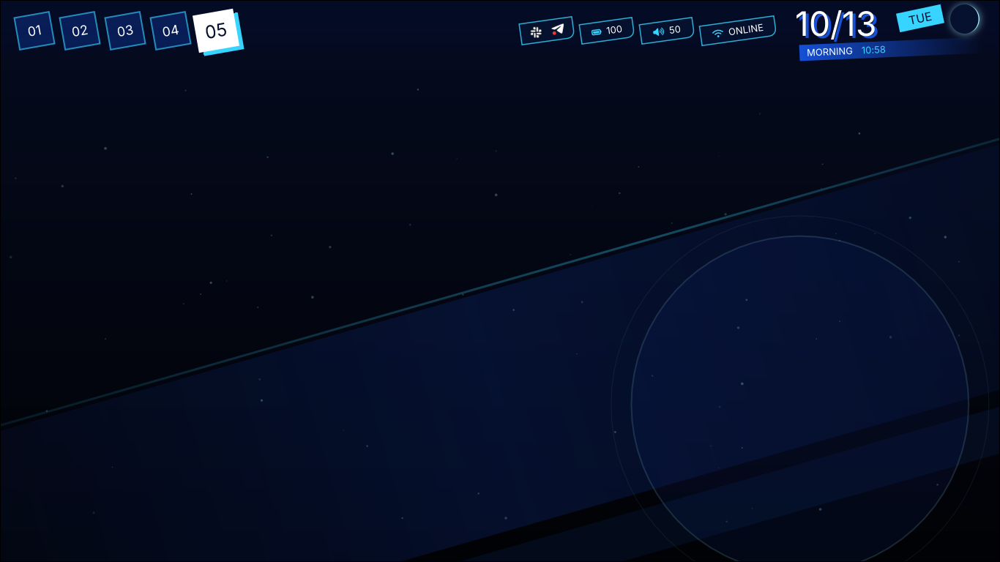
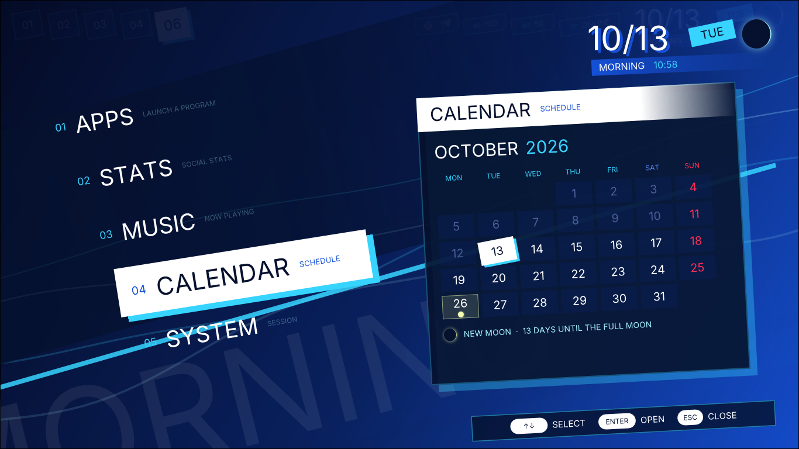

# amane-shell

A Persona 3 Reload–flavored desktop shell and HUD for Hyprland, built on the `amane` library.

## Preview

| HUD                                                                | Launcher                                                              |
| ------------------------------------------------------------------ | --------------------------------------------------------------------- |
|  |  |

## Run

```sh
amane dev       # build, start, rebuild + restart on save
amane compile   # build the optimised shell
amane run       # start the compiled shell (never builds)
```

## IPC

```sh
amane ipc call <name> [arguments...]
```

| Handler          | Action                                                |
| ---------------- | ----------------------------------------------------- |
| `menu`           | Toggle the launcher                                   |
| `settings [tab]` | Open settings (`power`, `battery`, `network`, `wifi`) |
| `player`         | Toggle the media player                               |
| `lock`           | Lock the screen                                       |
